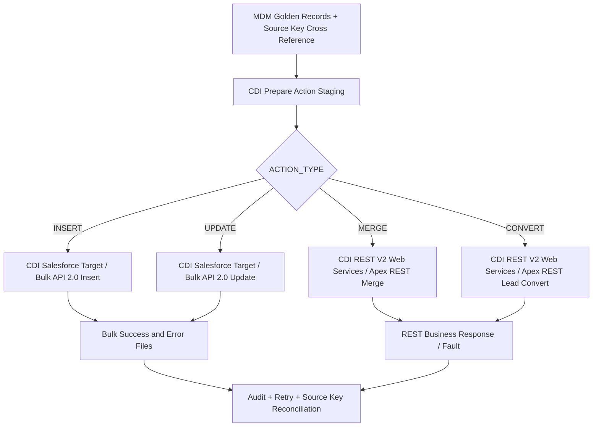

# Informatica MDM Golden Record → Salesforce 回写实施方案（混合架构版）

> 版本：v2.0 · 2026-10-26  
> 适用：Informatica IDMC Cloud Data Integration (CDI)；Salesforce Account / Lead；MDM 已保存 Salesforce `Account.Id` / `Lead.Id` 作为 Source Key。  
> **核心变更**：**Insert / Update 用 Informatica 原生 Salesforce Connector + Bulk API 2.0**；**Account Merge / Lead Convert 使用专用 Salesforce API，CDI 通过 REST V2 调用 Salesforce 提供的 REST 封装**。不再把 REST V2 作为大批量 Account Insert/Update 的默认方案。

## 1. 技术决策摘要

| 操作 | 推荐连接器/组件 | Salesforce 能力 | 为什么 |
|---|---|---|---|
| Account **Insert** | Salesforce Connector → Salesforce Target | **Bulk API 2.0 ingest**（Insert） | 成千上万行、原生 Salesforce 对象映射、自动 Job/CSV/异步流程、结果文件 |
| Account **Update** | Salesforce Connector → Salesforce Target | **Bulk API 2.0 ingest**（Update；使用 Account.Id） | MDM Source Key 已有 Account.Id，无需创建 External ID 字段 |
| Account **Merge** | REST V2 Connection + **Web Services Transformation**；或独立 API 层 | Salesforce 官方 **SOAP `merge()`**；若要 REST，使用 Salesforce 团队实现的 **Apex REST 包装** | Merge 是实体合并、Winner/Loser 与关联记录调整，非 Bulk Update；需要获取逐条业务结果 |
| Lead **Convert** | REST V2 Connection + **Web Services Transformation**；或独立 API 层 | Salesforce 官方 **SOAP `convertLead()`**；若要 REST，使用 **Apex REST 包装** | Convert 创建/关联 Account、Contact、Opportunity；需回收生成 ID 和处理业务校验 |
| Audit / Retry | CDI Taskflow + Audit Tables + Success/Error Files | Bulk Job results / REST response | 保证可核对、可重试、可更新 MDM source-key 映射 |

**重要区别**：Salesforce 标准原生 `merge()`、`convertLead()` 是 **SOAP API** 操作，并不是通用标准 REST `/sobjects/Account/{id}/merge` 和 `/lead/convert` URL。文档里的 REST URL 是**自定义 Apex REST API 示例**，要由 Salesforce 团队部署后才能调用。

### 1.1 为什么选择 Salesforce Connector 处理 Insert/Update

1. **技术支持**：Informatica Salesforce Connector 官方指南明确介绍 mappings / mapping tasks 的 Salesforce Bulk API 与 Bulk API 2.0，以及 Salesforce target 的高级设置和监控。
2. **吞吐与调用次数**：Bulk API 2.0 是专为批量 ingest 设计的异步 API；无需为每一条 Golden Record 调用一次通用 REST PATCH/POST，也不需要自己开发 create job → upload CSV → UploadComplete → poll → retrieve results。
3. **Mapping 更直观**：Target Object 是 Salesforce `Account`，直接映射 `Id`、`Name`、`Phone`、`BillingCity` 等对象字段，无需维护 REST V2 Swagger / Path Parameter / 层级 JSON 映射。
4. **可观测性**：配合 `Monitor Bulk API 2.0 Jobs` + `Use SFDC Success File` + `Use SFDC Error File`（属性名称随连接器/版本有所不同），可以保存成功与失败记录清单，提供生产对账基础。
5. **边界清晰**：Bulk API 2.0 支持 Insert/Update/Upsert/Delete，却**不等于支持 Account Merge 或 Lead Convert**。

**注意**：具体 UI 属性名会随 Salesforce Connector 版本、Mapping Task 和运行时有所差异；请按当前租户属性核对。Bulk API 2.0 不支持在 Connector 中选择 Bulk API 1.0 的 Serial Mode；需要通过减少竞争、按账户关联分批来优化锁争用。

## 2. 推荐端到端架构



**建议执行约束**：对于同一组 Salesforce Account，先执行依赖的 Merge 并核对 Winner，更新 MDM Source Key 关系，再按最终 Account.Id 运行 Update。无关联的 Insert 可独立执行，但需做好幂等控制。

## 3. 数据准备、Source Key 和路由规则

### 3.1 MDM Egress / Staging 示例

| GOLDEN_ID | SF_ACCOUNT_ID | SF_LEAD_ID | ACTION_TYPE | NAME | PHONE | CITY | WINNER_SF_ID | LOSER_SF_ID |
|---|---|---|---|---|---|---|---|---|
| G10001 | 001AAA... | | UPDATE | ABC Trading | 2125550100 | New York | | |
| G10002 | | | INSERT | New Company | 4155550100 | SF | | |
| G10003 | | | MERGE | Merged Co | | | 001WIN... | 001LOS... |
| G10004 | | 00QAAA... | CONVERT | New Lead | | | | |

这些是**业务示例字段**，不是 Informatica MDM 标准产品自动生成的固定 Schema。ID 值在真正调 Salesforce 前应换为有效的 15/18 位 Salesforce ID。

### 3.2 Action 规则

- **UPDATE**：存在有效 `Account.Id` 且仍在 Salesforce 中可更新。一个 Golden Record 对应多个 Salesforce Account 时，明确是全部更新还是仅更新 Survivor；不能默认一对一。
- **INSERT**：确认没有应复用的 Salesforce Account，并完成 Duplicate / Existing Key Check；处理成功之后写回新产生的 Salesforce Id。
- **MERGE**：明确 Winner / Loser；先评估 Contact、Opportunity、Hierarchy 和自动化影响；Merge 成功前不能将 Loser Source Key 置为失效。
- **CONVERT**：Lead → Account/Contact（可选 Opportunity），与普通 Account Insert 不同；决定关联已存在 Account 还是新建。

推荐 Audit 主键：`run_id + action_type + golden_id + source_record_id`，Merge 额外保存 `winner_id`、`loser_id`；Convert 保存 `lead_id`。跨系统双写需通过状态机与补偿逻辑处理，不能假定一个事务。

## 4. Insert Mapping — 原生 Salesforce Connector + Bulk API 2.0

### 4.1 创建 Salesforce Connection

进入 **IDMC Administrator → Connections → New**：

- Connection Name：`CONN_SF_CRM`
- Type：**Salesforce**（不是 REST V2）
- Runtime Environment：可访问 Salesforce 的 Secure Agent
- Salesforce 登录域、认证及 Integration User：按组织 Salesforce Connector 支持的认证方式配置，使用最小权限。
- 连接测试成功后保存。

### 4.2 Mapping 配置

`M_MDM_SF_ACCOUNT_INSERT`

`Source (MDM Egress / Staging) → Filter (ACTION_TYPE='INSERT') → Expression → Salesforce Target(Account)`

| Source 字段 | Salesforce Target 字段 | 说明 |
|---|---|---|
| `GOLDEN_CUSTOMER_NAME` | `Name` | Account 必需业务字段 |
| `GOLDEN_PHONE` | `Phone` | 电话 |
| `GOLDEN_CITY` | `BillingCity` | 地址 |
| `GOLDEN_COUNTRY` | `BillingCountry` | 地址 |
| `SF_ACCOUNT_ID` | **不映射 Id** | Insert 时由 Salesforce 生成 |

在 Target 选择 `CONN_SF_CRM` / Object `Account`。在 Mapping Task 配置目标操作为 **Insert**，并在相应 Salesforce API/Target advanced settings 中选 **Bulk API 2.0**（具体位置按版本 UI）。

**关键后处理**：从成功结果文件获取新 `Account.Id`，按 staging correlation key 与 Golden ID 关联，回写 MDM Cross Reference / Source Key。若 Bulk Success 文件不保留所需的业务关联键，先在 Staging 保留可稳定关联的业务键，并在 POC 检验成功文件字段。仅依赖 Salesforce 新 Id 而不能关联 MDM Golden ID，会造成下一次重复 Insert 风险。

### 4.3 示例输入 CSV（供理解；CDI Connector 负责传输，不必人工制作）

```csv
Name,Phone,BillingCity,BillingCountry
New Company,4155550100,San Francisco,USA
New Company Two,6175550199,Boston,USA
```

## 5. Update Mapping — 原生 Salesforce Connector + Bulk API 2.0

`M_MDM_SF_ACCOUNT_UPDATE`

`Source → Filter (ACTION_TYPE='UPDATE' AND Account.Id present) → Expression → Salesforce Target(Account)`

| MDM / Egress 字段 | Salesforce 字段 |
|---|---|
| `SF_ACCOUNT_ID` (Source Key) | **`Id`** |
| `GOLDEN_CUSTOMER_NAME` | `Name` |
| `GOLDEN_PHONE` | `Phone` |
| `GOLDEN_CITY` | `BillingCity` |

操作选择 **Update**，并启用 **Bulk API 2.0**。

示例输入：

```csv
Id,Name,Phone,BillingCity
001XXXXXXXXXXXXAAA,ABC Trading Ltd,2125550100,New York
001XXXXXXXXXXXXBBB,XYZ Global,4155550100,San Francisco
```

**不需要 Salesforce 自定义 External ID 字段**：已有 `Account.Id` 足够用于 Update；若要改为 Upsert 才需要重新审查具体匹配字段、重复创建风险及幂等策略。

**注意 Null 规则**：空值是“保持原值”还是“清空 Salesforce 字段”要按 Source/Target 映射和 Connector 的 `Set Fields to Null` / 同类选项明确配置。避免 MDM 空字段意外覆盖 Salesforce。

## 6. Mapping Task：启用 Bulk API 2.0、监控和行级结果

1. 在 **Data Integration → New → Mapping Task**，关联 Insert 或 Update Mapping。
2. 配置适当的 Target Operation（Insert / Update）。
3. 在 Salesforce API 相关高级选项选择 **Bulk API 2.0**；检查 IDMC/Connector 版本是否出现该选项。
4. 启用 **`Monitor Bulk API 2.0 Jobs`** 或版本中等价监控设置。
5. 启用 **`Use SFDC Success File`**、**`Use SFDC Error File`**（或相应 `Create Success File` / `Monitor Bulk Job`）；设置可访问的 Success/Error 文件路径。
6. 在 **Monitor → All Jobs / Job Details** 检查实际 Salesforce Job 状态、处理计数和 Session Log。
7. 解析保存的 Success/Error 文件，形成 `GOLDEN_ID + SF_ID + ACTION + STATUS + ERROR` 对账明细；把失败和未处理数据送入 Retry Queue。

Informatica 官方指南指出，监控开启时会跟踪 Bulk Job 状态并提供准确统计，Success/Error CSV 含行级记录；**未启用监控时不应仅靠 Mapping Task 的 Completed 状态当成 Salesforce 每一行都完成**。某些 Connector/版本文件在 Secure Agent 的 `apps/Data_Integration_Server/data/success` 和 `.../error` 中，或映射到 `$PMTargetFileDir`、`$PMBadFileDir`；以当前版本配置为准。

Salesforce Bulk API 2.0 本身可取得 `successfulResults`、`failedResults`、`unprocessedrecords`。**JobComplete 不代表 0 failed rows**；失败/未处理文件必须一并读取。对比：

| 类型 | 示例 | 处理 |
|---|---|---|
| Success | 19,950 条 | 标记 SYNCED；Insert 关联新 Account.Id |
| Failed | 45 条 | 记录 Salesforce 错误，纠错或退避重试 |
| Unprocessed | 5 条 | 检查中断/超时后补发 |
| 合计 | 20,000 条 | 与准备提交记录总数对账 |

**性能考虑**：Bulk API 2.0 在 Salesforce 侧自动分批，适合数千/数万级别；不要按固定阈值假定一定快于标准 API，需结合 org 配额、触发器/Flow、对象锁、数据规模和 SLA 测试。高关联 Account 更新易出现 `UNABLE_TO_LOCK_ROW`；考虑将争用数据拆分为较小作业并限制并发。

## 7. Merge — Salesforce 官方 SOAP merge() + Apex REST 包装

### 7.1 官方能力与约束

Salesforce 官方提供 **SOAP API `merge()`**，支持 Account；一次合并一个主记录和最多两个被合并记录。同类记录才能合并，Loser 被删除（可由 queryAll 检索已合并的删除记录），受支持关联对象可能重新指向 Winner。需认真评估关联数据、账户层级、权限和自动化副作用。

**本方案使用 REST V2 的条件**：Salesforce 团队提供一个 **自定义 Apex REST API**，内部调用 Salesforce Apex `Database.merge(...)`，并明确返回业务结果；这不是 Salesforce 自带的 `/services/apexrest/mdm/account-merge` 标准路由。

### 7.2 自定义 Merge API 合约（示例）

`POST https://<my-domain>.my.salesforce.com/services/apexrest/mdm/account-merge`

Request：

```json
{
  "requestId": "MERGE-G10003-001LOS",
  "goldenId": "G10003",
  "winnerAccountId": "001WINNER000000AAA",
  "loserAccountIds": ["001LOSER0000000AAA"]
}
```

Success Response（**自定义**）：

```json
{
  "requestId": "MERGE-G10003-001LOS",
  "success": true,
  "winnerAccountId": "001WINNER000000AAA",
  "mergedLoserIds": ["001LOSER0000000AAA"],
  "errors": []
}
```

Failure Response（**自定义**；HTTP 4xx/5xx，不能用 200 + `success:false` 却仅按 HTTP 判成功）：

```json
{
  "requestId": "MERGE-G10003-001LOS",
  "success": false,
  "winnerAccountId": "001WINNER000000AAA",
  "mergedLoserIds": [],
  "errors": [
    {"code": "MERGE_VALIDATION_FAILED", "message": "Account hierarchy conflict"}
  ]
}
```

### 7.3 CDI Mapping 设计

`M_MDM_SF_ACCOUNT_MERGE`

`Source (Merge Actions) → Expression → Web Services Transformation → Response Mapping → Audit Target`

配置：

1. 将上面的 REST API 定义成 Swagger 2.0 或 OpenAPI 3.x JSON，描述 POST /mdm/account-merge、Request JSON、成功和失败 Response。
2. 建 `CONN_SF_MDM_API` REST V2 Connection，Swagger 指向已部署 Apex REST 服务，配置 OAuth 和 Secure Agent。
3. 建 Business Service `BS_SF_ACCOUNT_MERGE`，选择 Operation `mergeAccounts`。
4. Web Services Transformation 的 **Request Mapping** 映射 `requestId`、`goldenId`、`winnerAccountId`、`loserAccountIds`；数组要按照层级/Group 映射规则构造，不能假定一列 CSV 文本自动变成 JSON array。
5. **Response Mapping** 抽取 `success`、`winnerAccountId`、`mergedLoserIds`、错误码和错误文本；同时映射 Fault Group。
6. **只在确认 Salesforce Merge 成功后**：让 MDM Source Key 的 Loser 链接失效，并保存 Loser → Winner 映射；失败则保留原始 Source Key，进入重试/人工审批。

**幂等性**：由于 Merge 具有删除副作用，REST 请求超时不代表 Salesforce 没完成。自定义服务必须使用 `requestId` 去重，并在已 Merge/重试时检查 Salesforce 当前状态（如 `MasterRecordId`），避免重复 Merge。

## 8. Convert — Salesforce 官方 SOAP convertLead() + Apex REST 包装

此处的 **Convert 指 Lead Convert**。如果你们的 Convert 是自定义业务操作（例如 Person Account 转型），需要重新定义接口。

Salesforce 原生 **SOAP `convertLead()`** 支持将 Lead 转成 Account 和 Contact，并可选创建 Opportunity，也可指定已有的 `accountId` / `contactId`；需要对应 Convert Leads 和对象级访问权限。

建议 Salesforce 团队提供 **自定义 Apex REST** 包装并调用 Salesforce Apex `Database.convertLead(...)`，供 CDI Web Services Transformation 接收结果：

`POST https://<my-domain>.my.salesforce.com/services/apexrest/mdm/lead-convert`

Request（自定义）：

```json
{
  "requestId": "CONVERT-G10004-00QAAA",
  "goldenId": "G10004",
  "leadId": "00Q000000000001AAA",
  "existingAccountId": "001000000000001AAA",
  "convertedStatus": "Qualified",
  "doNotCreateOpportunity": true
}
```

Response（自定义）：

```json
{
  "requestId": "CONVERT-G10004-00QAAA",
  "success": true,
  "leadId": "00Q000000000001AAA",
  "accountId": "001000000000001AAA",
  "contactId": "003000000000001AAA",
  "opportunityId": null,
  "errors": []
}
```

CDI Mapping：`Source (Convert Action) → REST V2 Web Services Transformation → Response → Audit + MDM Source Key Update`。成功后保存生成或关联的 `Account.Id` / `Contact.Id`，同步 Lead 状态，并维护跨系统 Cross Reference。`convertedStatus` 应是 Salesforce 组织允许的 Converted Lead Status，不是随意字符串。

**为什么使用 Web Services 而不是 REST V2 Target？** Merge 与 Convert 的 API Response 含新对象 ID、业务 success 和错误详情，直接决定 MDM Source Key 的后续更新，因此需要在 Mapping 中接收/解析 Response。若所有业务成功/失败由 API 服务自身持久化并异步回调，也可以用 REST V2 Target，但审计链路必须另行设计。

## 9. 连接与任务编排建议

- `CONN_SF_CRM`：**Salesforce Connector**，Insert/Update 的两个 CDI Mapping 共享此 Connection。
- `CONN_SF_MDM_API`：**REST V2 Connector**，Merge/Convert 共享一个 Connection 的条件是 **同一 Salesforce Host、认证、兼容的 Swagger Operation Schema**；否则拆分为两个 REST V2 Connections。
- `M_MDM_SF_ACCOUNT_INSERT` → Bulk API 2.0 Insert。
- `M_MDM_SF_ACCOUNT_UPDATE` → Bulk API 2.0 Update。
- `M_MDM_SF_ACCOUNT_MERGE` → REST V2 Web Services → 自定义 Merge API。
- `M_MDM_SF_LEAD_CONVERT` → REST V2 Web Services → 自定义 Convert API。
- `TF_MDM_SF_WRITEBACK`：路由、前置检查、Merge → Cross Reference Reconcile → Update；Insert 独立或按依赖运行，最后执行 Audit + Failed/Unprocessed Retry。

**Taskflow 统计**：Data Task 的 `Success_Target_Rows` 和 `Failed_Target_Rows` 可做 CDI 运行监控，但 Bulk API 的 Salesforce **行级结果**、自定义 Merge/Convert 的 **Response success/fault** 才是 Salesforce 业务写入结果的判断依据。业务审计示例：

```text
RUN_ID | GOLDEN_ID | ACTION | SF_RECORD_ID | SF_JOB_ID | STATUS | ERROR_CODE | RETRY_COUNT
```

建议记录 Source System、Operation 版本、Input Hash、开始/结束时间、HTTP Status 或 Bulk Result，防止无法追查重复回写与循环同步。

## 10. 生产环境 POC / UAT 测试清单

| 测试场景 | 预期 |
|---|---|
| Bulk Insert 100 / 10,000 行 | 成功文件可对应新 Account.Id；不存在无意重复记录 |
| Bulk Update 100 / 10,000 行 | 通过 `Account.Id` 定位并更新 |
| 1 行 Salesforce Validation Rule 失败 | Error File 有对应记录；其他行成功处理 |
| Job 因限流/超时中断 | Failed / Unprocessed 可核对、仅对必要记录重试 |
| Salesforce 自动化触发 Account Lock | 有重试与隔离策略 |
| Merge Winner + 1 Loser | 成功回传 Winner；Loser Cross Reference 失效并保留审计 |
| Merge 被权限/Hierarchy 拒绝 | MDM Source Key 不得提前变更 |
| Merge 请求超时后重试 | 幂等检查，不能因重复请求产生非预期变更 |
| Convert 指定已有 Account | 返回预期 Account.Id / Contact.Id / 状态 |
| Convert 输入已转换 Lead | 不重复创建；返回可审计业务结果 |
| Salesforce → MDM 反向同步 | 防止无限循环（来源标志、字段归属和版本比较） |

## 11. 官方技术支持文档与视频入口

### Informatica 官方

1. **Salesforce Connector Guide（含 Bulk API 2.0、Mapping Target、Bulk Monitoring、Success/Error files）**：  
   https://docs.informatica.com/content/dam/source/GUID-F/GUID-F3409595-C41F-486D-ACD0-D4C59E670B4D/38/en/__SalesforceConnector_en.pdf  
   关键搜索：`Bulk API 2.0`, `Monitor Bulk API 2.0 Jobs`, `Use SFDC Success File`, `Use SFDC Error File`。
2. **Salesforce Connector Guide — 另一版本（Bulk Job Monitoring 章节）**：  
   https://docs.informatica.com/content/dam/source/GUID-F/GUID-F3409595-C41F-486D-ACD0-D4C59E670B4D/30/en/CDI__SalesforceConnector_en.pdf
3. **REST V2 Connector Guide（Merge/Convert 自定义 REST 接口的 Web Services Transformation）**：  
   https://docs.informatica.com/content/dam/source/GUID-4/GUID-4D4C13E1-7BF0-4267-B56A-E2DFD055F69D/42/en/__%28REST%29V2Connector_en.pdf
4. **Informatica KB：REST ENDPOINT IMPLEMENTATION USE CASE**：  
   https://knowledge.informatica.com/s/article/REST-ENDPOINT-IMPLEMENTATION-USE-CASE?language=en_US&type=external
5. **Informatica 官方演示视频 — REST V2 Midstream**：  
   https://success.informatica.com/videos/support-videos/lfh0JIV32Lg.html  
   （用于 Merge/Convert 的 REST V2 Web Services 过程，不是 Bulk API 2.0 Target 视频。）
6. **Informatica 官方演示视频 — REST V2 OAuth**：  
   https://success.informatica.com/videos/support-videos/vdAjwnfPR2o.html

### Salesforce 官方

7. **Salesforce Bulk API 2.0 Ingest**：  
   https://developer.salesforce.com/docs/platform/api-asynch/guide/bulk-api-2-0-ingest.html
8. **Bulk API 2.0 Job 状态 / 结果**：  
   https://developer.salesforce.com/docs/platform/api-asynch/guide/bulk-api-2-job-states.html
9. **Bulk API 2.0 Unprocessed Results**：  
   https://developer.salesforce.com/docs/platform/api-asynch/guide/get-job-unprocessed-results.html
10. **Salesforce SOAP `merge()` 官方说明**：  
    https://developer.salesforce.com/docs/platform/api/guide/sforce-api-calls-merge.html
11. **Salesforce SOAP `convertLead()` 官方说明**：  
    https://developer.salesforce.com/docs/platform/api/guide/sforce-api-calls-convertlead.html

> **视频说明**：以上仅列已识别到的官方 REST V2 教程；未核实到同时演示 Salesforce Connector Bulk API 2.0 Insert/Update 与 Salesforce Merge/Convert 自定义 API 的单个官方视频，不应将 REST Midstream 视频误当作 Bulk Connector 教程。

---

## 12. 最终 API Request / Response JSON 实施示例

此节集中给出示例。**Insert/Update 推荐采用原生 Salesforce Connector，不需要手工构造以下 Bulk REST Job JSON**；列出 Bulk API 2.0 JSON 是为了说明 Connector 底层所封装的 Salesforce API 模型及便于排障。所有 ID、Host、业务字段均为演示值。

### 12.1 Insert：Bulk API 2.0 Create Job（技术原理）

`POST /services/data/vXX.X/jobs/ingest`

**Request JSON**：

```json
{
  "object": "Account",
  "operation": "insert",
  "contentType": "CSV",
  "lineEnding": "LF"
}
```

**Response JSON（示意，仅展示关键字段）**：

```json
{
  "id": "750000000000001AAA",
  "operation": "insert",
  "object": "Account",
  "state": "Open",
  "contentType": "CSV"
}
```

后续上传 `Name,Phone,BillingCity` CSV，再设置 Job `UploadComplete`，并获取 Successful/Failed/Unprocessed results。实际生产中这些步骤交由 Informatica Salesforce Connector 完成。

### 12.2 Update：Bulk API 2.0 Create Job（技术原理）

**Request JSON**：

```json
{
  "object": "Account",
  "operation": "update",
  "contentType": "CSV",
  "lineEnding": "LF"
}
```

**Response JSON（示意）**：

```json
{
  "id": "750000000000002AAA",
  "operation": "update",
  "object": "Account",
  "state": "Open",
  "contentType": "CSV"
}
```

Update CSV 必须包含 `Id` 列；例如：

```csv
Id,Name,Phone
001XXXXXXXXXXXXAAA,ABC Trading Ltd,2125550100
001XXXXXXXXXXXXBBB,XYZ Global,4155550100
```

### 12.3 Merge：自定义 Salesforce Apex REST（业务示例）

`POST /services/apexrest/mdm/account-merge`

**Request JSON**：

```json
{
  "requestId": "MERGE-G10003-001LOS",
  "goldenId": "G10003",
  "winnerAccountId": "001WINNER000000AAA",
  "loserAccountIds": ["001LOSER0000000AAA"]
}
```

**Response JSON（自定义成功示例）**：

```json
{
  "requestId": "MERGE-G10003-001LOS",
  "success": true,
  "winnerAccountId": "001WINNER000000AAA",
  "mergedLoserIds": ["001LOSER0000000AAA"],
  "errors": []
}
```

### 12.4 Convert：自定义 Salesforce Apex REST（业务示例）

`POST /services/apexrest/mdm/lead-convert`

**Request JSON**：

```json
{
  "requestId": "CONVERT-G10004-00QAAA",
  "goldenId": "G10004",
  "leadId": "00Q000000000001AAA",
  "existingAccountId": "001000000000001AAA",
  "convertedStatus": "Qualified",
  "doNotCreateOpportunity": true
}
```

**Response JSON（自定义成功示例）**：

```json
{
  "requestId": "CONVERT-G10004-00QAAA",
  "success": true,
  "leadId": "00Q000000000001AAA",
  "accountId": "001000000000001AAA",
  "contactId": "003000000000001AAA",
  "opportunityId": null,
  "errors": []
}
```

**实施提醒**：上述 Merge / Convert REST Request/Response 是你们需要和 Salesforce 团队确认、实现并发布 Swagger 的**自定义接口契约**；官方直接提供的是 SOAP `merge()` / `convertLead()` 能力。REST V2 Web Services 配置完成后还需运行 POC 验证认证、Fault Group、数组映射、超时和响应关联键。
